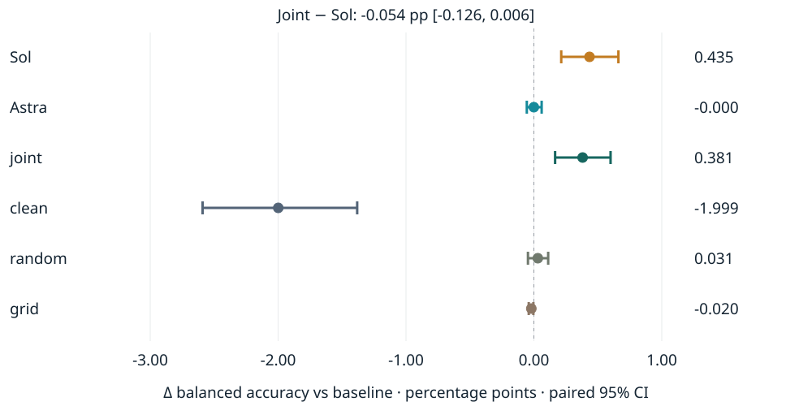

# Editing Neural Networks with Language Models

**Independent and Cooperative Weight Editing on Adult and SmolLM2**  
Davut Emre ([detasar](https://github.com/detasar)) · 4 November 2026


Can a language model improve a decision rule by editing a few weights? Adult
shows a small balanced-accuracy gain with an accuracy and calibration tradeoff.
Completed SmolLM2 v2 searches propose real edits but select the unchanged origin.

[Interactive research presentation](https://detasar.github.io/llm-weight-editing-study/)
· [HTML report](https://detasar.github.io/llm-weight-editing-study/?view=report)
· [Report PDF](report/report.pdf) · [Deck PDF](presentation/presentation.pdf)
· [Offline ZIP](presentation/weight-editing-offline.zip)
· [Reproduce](docs/REPRODUCE.md) · [Delivery index](docs/DELIVERY.md)



| Adult state | Balanced accuracy ↑ | Accuracy ↑ | ROC-AUC ↑ | Log-loss ↓ | Brier ↓ |
| --- | ---: | ---: | ---: | ---: | ---: |
| baseline | 78.585785% | 82.857318% | 0.889869 | 0.378285 | 0.120487 |
| Sol | 79.020686% | 82.630060% | 0.889981 | 0.382725 | 0.122237 |
| Astra | 78.585515% | 82.802039% | 0.889885 | 0.378581 | 0.120608 |
| joint | 78.966808% | 82.630060% | 0.889975 | 0.382383 | 0.122106 |
| clean | 76.586901% | 85.633561% | 0.907734 | 0.314733 | 0.100082 |
| random | 78.616475% | 82.808181% | 0.889981 | 0.378680 | 0.120655 |
| grid | 78.565680% | 82.826608% | 0.889862 | 0.376637 | 0.120089 |

All rows use the same 16,281 held-out examples. The intact clean
reference has lower BA than damaged but better accuracy, ranking and probability
quality. Sol rescues 65 positives and regresses 102 negatives; joint rescues 59
positives and regresses 96 negatives. Balanced accuracy weights the classes equally.
The paired forest plot shows example uncertainty in one exploratory session.
Original Adult solo allowance: ten candidates each; joint: five with development
history. This is an endpoint comparison, not equal-compute evidence of synergy.

| Completed LM v2 task | n | acc_norm | Raw acc |
| --- | ---: | ---: | ---: |
| arc_easy | 512 | 73.437500% | 77.343750% |
| piqa | 256 | 78.515625% | 80.078125% |

Baseline, Sol, Astra and joint all select candidate zero: **one executed state**,
not four independent observations. Sol and Astra each measured five nonempty
candidates. Joint made five attempts, including an invalid first attempt with no
score. The new v2 final pass used 2,558 choice
forwards for 768 examples in
247.999872 native forward seconds. Full native
work, exact-state reuse and selection details are in the report and manifest.

The canonical numerical source is [data/manifest.json](data/manifest.json).
README tables, report and deck bind manifest identity:

`8f8869a113d93000bb8fffd547258b36ab955a6bf7a7f8ddbe589fbdbd231d38`

Historical v1 appears only in method history. v2 corrects the dtype wording to
float32, with fresh source sessions on previously exposed panels; it is not an
independent replication. Exporting this snapshot makes no model calls; the
original v2 measurement completed. [Methods](docs/METHODS.md),
[scorer](docs/SCORER.md), [versions](docs/VERSIONS.md),
[exact prompts](prompts/v2), [configuration](configs).

Build and present locally (Node 24+, dependencies installed once):

```sh
npm --prefix web ci
npm --prefix web run build
npm --prefix web run dev
npm --prefix web run test
npm --prefix web run qa
npm --prefix web run export:pdf
npm --prefix web run package:offline
```

The offline ZIP includes all fonts, runtime assets, PDF backups and `launch.py`.
Unzip and run `python3 launch.py`; no installation or internet is needed during
the presentation. Arrows navigate 22 scenes, the menu opens any scene or appendix,
Pause stops schematic motion, and Presenter provides notes and a talk timer.
Use `?renderer=2d` for the semantic SVG fallback, or reduce motion in the toolbar
or operating system. Drag a 3D network to orbit, scroll to zoom, and focus an exact
patch with the view controls. [35-minute speaker notes](docs/SPEAKER_NOTES.md)
include transitions and demo backups; Q&A is five additional minutes.

The interface is TypeScript/Vite/Three.js/KaTeX with pinned dependencies and
bundled fonts/licenses. Scientific figures are SVG; conceptual PNG art is used
only for cover and section context. Offline numeric verification and analysis
require no model or provider. Explicit new experiments are separate commands in
the reproduction guide.

Inspired by Takehi, Teoh, Zhang and Khattab,
[Sparks of Weight-Space Programming](https://rikiyat.github.io/blog/weight-space-programming/)
(2 November 2026). Our targets and intervention domains differ from that work.
See [one-page research summary](docs/KNOWLEDGE_RIP.md) and [citation](CITATION.cff).
Code: [MIT](LICENSE). Original report/artwork and derived numeric data:
[CC BY 4.0](CONTENT_LICENSE). Upstream model/data rights remain with their owners.
